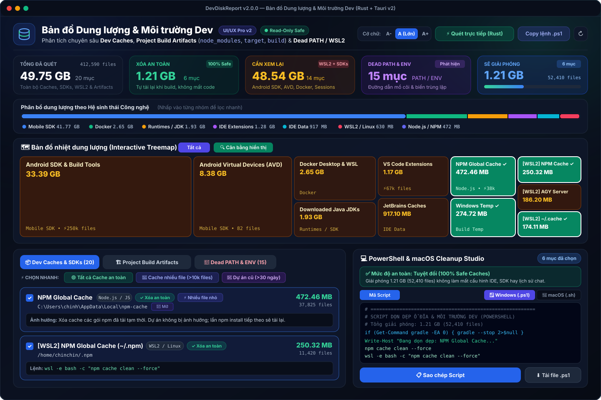

# 🚀 DevDiskReport — Bản đồ Dung lượng & Môi trường Dev (Windows / macOS / WSL2)

[](https://github.com/chinchindev/disk-report/actions/workflows/build-release.yml)

Công cụ phân tích chuyên sâu **Dev Caches**, **Project Build Artifacts** (`node_modules`, `target`, `build`, `.dart_tool`, `.next`, `.venv`) và **Dead `PATH` / Biến môi trường Dev** dành cho lập trình viên trên **Windows**, **macOS** và **WSL2**, được xây dựng bằng **Rust (Rayon + WalkDir)** và **Tauri v2**.



---

## ✨ Tính năng nổi bật

- **⚡ Quét đa luồng siêu tốc (Rust + Rayon)**: Quét song song hơn 35+ mục Dev Caches (`Android SDK`, `AVD`, `Gradle`, `NPM`, `PNPM`, `Yarn`, `Bun`, `Pip`, `uv`, `HuggingFace`, `Ollama`, `Cargo`, `Rustup`, `Go`, `NuGet`, `Playwright`, `Docker`, `Xcode DerivedData`, `CocoaPods`, `Homebrew`...) và môi trường **WSL2 (`/home/<user>`)**.
- **🏗️ Phát hiện Project Build Artifacts**: Tự động tìm `node_modules`, `target`, `build`, `.gradle`, `.dart_tool`, `.next`, `.nuxt`, `.venv` và đánh dấu các dự án cũ không hoạt động (`> 30 ngày`).
- **🔗 Kiểm tra Dead `PATH` & Biến môi trường bị hỏng**: Phát hiện đường dẫn mồ côi đã bị xóa hoặc trùng lặp trong `PATH` (`User` & `System`) và các biến `JAVA_HOME`, `ANDROID_HOME`, `FLUTTER_ROOT`, `GOPATH`, `NVM_SYMLINK`...
- **🗺️ Bản đồ nhiệt Treemap cân bằng & PowerShell / Bash Cleanup Studio**:
  - Chế độ hiển thị **Cân bằng (`Sqrt`)** và **Tỷ lệ tuyệt đối (`Linear`)**.
  - Tự động sinh script dọn dẹp an toàn cho cả **Windows (`.ps1`)** và **macOS / Linux (`.sh`)**, kèm chế độ chạy thử `-WhatIf` (Dry-run), tự dừng `gradle`/`adb` daemon và sao lưu biến `PATH` trước khi sửa.

---

## 📥 Hướng dẫn Tải & Cài đặt lên máy

Bạn có thể tải các bản cài đặt dựng sẵn từ trang **[GitHub Releases](https://github.com/chinchindev/disk-report/releases)** hoặc mục **Artifacts** trong **[GitHub Actions](https://github.com/chinchindev/disk-report/actions)**.

### 🪟 1. Cài đặt trên Windows (Windows 10 / 11 - 64-bit)

Trên Windows có **3 lựa chọn** tùy theo nhu cầu của bạn:

#### Cách A: Bản Portable — Chạy ngay không cần cài đặt (Khuyên dùng)
1. Tải file **`DevDiskReport-Portable-win-x64.exe`**.
2. Nhấp đúp chuột vào file để mở trực tiếp ứng dụng.
3. Bấm nút **"⚡ Quét trực tiếp (Rust)"** ở góc trên bên phải để quét toàn bộ ổ đĩa của máy bạn.

#### Cách B: Bộ cài đặt chuẩn Windows (`.exe` hoặc `.msi`)
1. Tải một trong hai file:
   - **`DevDiskReport_2.0.0_x64-setup.exe`** (Bộ cài NSIS nhỏ gọn, hỗ trợ cài nhanh cho User hiện tại).
   - **`DevDiskReport_2.0.0_x64_en-US.msi`** (Bộ cài Windows Installer chuẩn).
2. Nhấp đúp chuột để chạy trình cài đặt -> Bấm **Next / Install**.
3. Sau khi cài xong, mở **DevDiskReport** từ **Start Menu** hoặc **Desktop Shortcut**.

> 💡 **Lưu ý về Windows SmartScreen:**
> Vì đây là ứng dụng mã nguồn mở tự build trên GitHub (chưa mua chứng chỉ EV Code Signing của Microsoft), lần đầu mở trên Windows có thể hiện bảng xanh *"Windows protected your PC"*. Bạn chỉ cần bấm vào chữ **More info** -> chọn **Run anyway** là chạy bình thường.

---

### 🍎 2. Cài đặt trên macOS (Apple Silicon M1 / M2 / M3 / M4)

1. Tải file **`DevDiskReport_2.0.0_aarch64.dmg`** (hoặc `DevDiskReport-macos-arm64.app.tar.gz`).
2. Nhấp đúp vào file `.dmg` vừa tải và kéo biểu tượng **DevDiskReport.app** vào thư mục **Applications**.
3. **Mở lần đầu trên macOS (Bỏ qua Gatekeeper cho app chưa ký Apple Developer ID):**
   Mở **Terminal** và chạy lệnh sau một lần duy nhất:
   ```bash
   xattr -cr /Applications/DevDiskReport.app
   open /Applications/DevDiskReport.app
   ```

---

### 🐧 3. Sử dụng trên môi trường WSL2 (Windows Subsystem for Linux)

Nếu bạn đang dùng **WSL2 (Ubuntu / Debian)** song song với Windows:

1. Clone repository về máy:
   ```bash
   git clone https://github.com/chinchindev/disk-report.git
   cd disk-report
   ```
2. Chạy lệnh quét **Hybrid (Quét đồng thời cả `/home/<user>` trong WSL2 lẫn `C:\Users\<user>` trên Windows)**:
   ```bash
   ./run-wsl.sh
   ```
   Dashboard sẽ tự động cập nhật dữ liệu của cả 2 môi trường và mở lên trình duyệt Windows.

---

## 🛠️ Tự Build từ mã nguồn tại máy (Dành cho Developer)

### 1. Chạy bằng PowerShell thuần trên Windows (Không cần cài Rust):
```powershell
powershell -ExecutionPolicy Bypass -File "$HOME\disk-report\scan.ps1"
```

### 2. Tự Build ứng dụng Tauri v2 Desktop tại máy:
- **Trên Windows** (Tự động kiểm tra/cài đặt `vs_buildtools` & `cargo-tauri`):
  ```powershell
  # Chạy thử cửa sổ Dev:
  powershell -ExecutionPolicy Bypass -File "$HOME\disk-report\build-app.ps1" -Dev

  # Đóng gói ra file .exe / .msi trong target\release\bundle:
  powershell -ExecutionPolicy Bypass -File "$HOME\disk-report\build-app.ps1"
  ```
- **Trên macOS**:
  ```bash
  ./build-app.sh --dev   # Chạy chế độ Dev
  ./build-app.sh         # Đóng gói ra .app và .dmg
  ```
